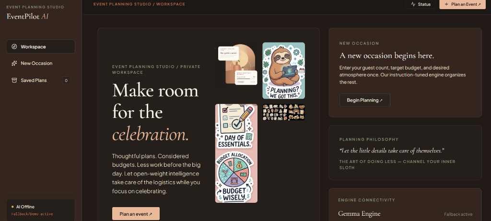
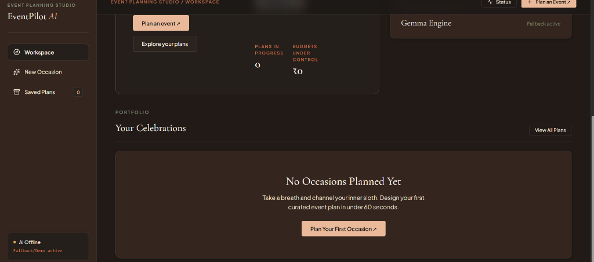
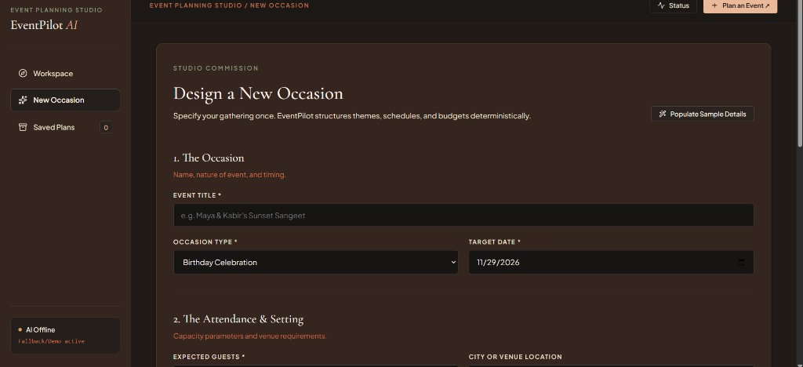
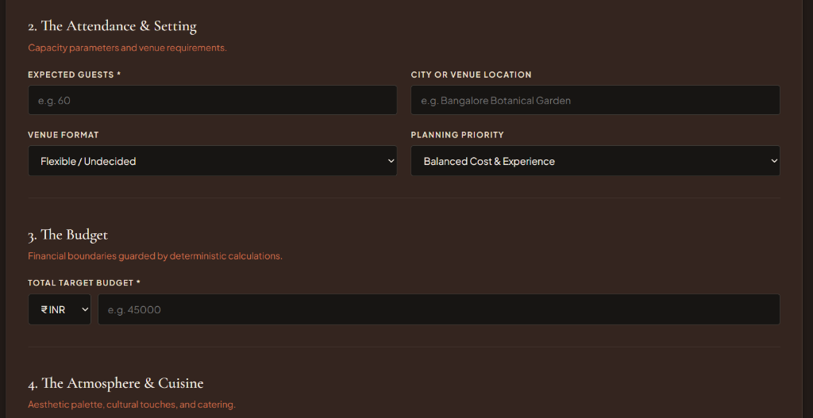
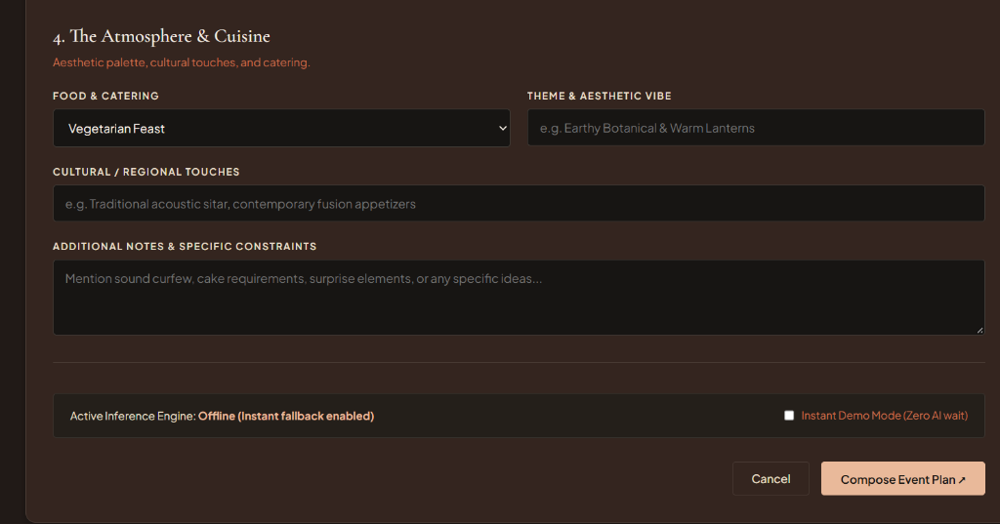
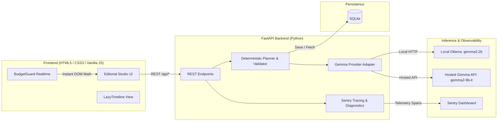

# EventPilot AI — Plan Less, Celebrate More 🦥

[](https://opensource.org/licenses/MIT)
[](https://fastapi.tiangolo.com)
[](https://ai.google.dev/gemma)
[](https://render.com)
[](https://sentry.io)
[](https://pytest.org)

**EventPilot AI** is an open-source, AI-powered event planning web application. Enter your event details once and get a personalized, editable, budget-aware plan — with itemized allocations, preparation milestones, vendor interview questions, and shopping checklists — all generated automatically.

> *You celebrate. EventPilot handles the planning.*

---

## 📸 Screenshots

### Dashboard — Workspace Overview


### Workspace — Plans & Stats


### New Occasion — Event Creation Form


### Attendance & Setting


### Atmosphere & Cuisine


---

## ✨ What It Does

Planning a birthday, college fest, wedding, or community event involves repetitive, time-consuming work: budget breakdowns, deadline tracking, vendor coordination, shopping lists. EventPilot AI automates all of it.

**Input once → Get a complete plan instantly.**

| Feature | Description |
|:---|:---|
| 🎯 **AI Event Planning** | Gemma-powered personalized plan generation (themes, timelines, vendors) |
| 💰 **BudgetGuard** | Deterministic budget allocation and real-time over-budget detection |
| 📅 **LazyTimeline** | Auto-calculated preparation milestones grouped by phase |
| 🛒 **Shopping Checklists** | Context-aware item lists per event type |
| 🏪 **Vendor Tracker** | AI-estimated costs vs. real quotes with comparison table |
| 📊 **Dashboard Stats** | Live plans-in-progress and budgets-under-control metrics |
| 🌐 **Offline Fallback** | Instant demo mode when AI is offline — full UI always works |
| 🔭 **Sentry Observability** | Agent tracing with custom spans for every AI generation call |

---

## 🏗 Architecture



---

## 🛠 Prerequisites

- **Python:** 3.10 – 3.14
- **OS:** Windows 10/11, macOS, or Linux
- **RAM:** 8 GB minimum (CPU inference, no GPU required)
- **Ollama** *(optional, for local AI)*: [Download](https://ollama.com/download)

---

## 🚀 Quickstart

### 1. Clone & Install
```powershell
git clone https://github.com/riyanshika7/EVENTPILOT.git
cd EVENTPILOT
python -m pip install -r requirements.txt
```

### 2. Configure Environment
```powershell
Copy-Item .env.example .env
```
Default settings in `.env`:
```ini
AI_PROVIDER=ollama
GEMMA_MODEL=gemma2:2b
INFERENCE_BASE_URL=http://localhost:11434
SENTRY_DSN=""
SENTRY_ENVIRONMENT=development
PORT=8000
HOST=0.0.0.0
```

### 3. (Optional) Pull Gemma Locally
```powershell
ollama pull gemma2:2b
```
> If constrained on RAM, `gemma3:1b` also works. Without Ollama, the app runs in instant demo mode automatically.

### 4. Run the App
```powershell
python -m uvicorn backend.main:app --port 8000 --host 0.0.0.0 --reload
```
Open: **http://localhost:8000**  
API docs: **http://localhost:8000/docs**

---

## ☁️ Deploy on Render

1. Push the repo to GitHub (already done).
2. Go to [render.com](https://render.com) → **New → Web Service**.
3. Connect your GitHub repo (`riyanshika7/EVENTPILOT`).
4. Set the following:

| Setting | Value |
|:---|:---|
| **Runtime** | Python 3 |
| **Build Command** | `pip install -r requirements.txt` |
| **Start Command** | `python -m uvicorn backend.main:app --host 0.0.0.0 --port $PORT` |
| **Instance Type** | Free (or Starter) |

5. Add Environment Variables in the Render dashboard:
   - `AI_PROVIDER` → `hosted` (for Render; Ollama is not available on Render)
   - `GEMMA_MODEL` → your hosted model name
   - `INFERENCE_BASE_URL` → your hosted inference endpoint
   - `SENTRY_DSN` → your Sentry DSN (optional)
6. Click **Deploy**. Render auto-deploys on every push to `main`.

> **Note:** SQLite data is ephemeral on Render's free tier. For persistence across deploys, attach a Render Disk or use a managed database.

---

## 🧪 Tests

```powershell
python -m pytest -q
```

**29 tests pass** covering:
- Health endpoint and environment reporting
- Gemma model status query
- Diagnostic telemetry buffer
- Demo mode generation and span recording
- Input validation and bad payload rejection
- SQLite CRUD full lifecycle
- Deterministic budget math and rounding balance
- Real-time over-budget detection
- Task deadline offsets and overdue calculations
- Fallback schema validation

---

## 🔌 API Reference

| Method | Endpoint | Description |
|:---|:---|:---|
| `GET` | `/api/health` | Health check and telemetry status |
| `GET` | `/api/model/status` | Real-time Gemma connectivity status |
| `GET` | `/api/diagnostics` | In-memory telemetry summary |
| `POST` | `/api/events/generate` | Generate a validated event plan |
| `POST` | `/api/events` | Save an event plan |
| `GET` | `/api/events` | List all saved event summaries |
| `GET` | `/api/events/{event_id}` | Retrieve full plan by ID |
| `PUT` | `/api/events/{event_id}` | Update tasks, quotes, or allocations |
| `DELETE` | `/api/events/{event_id}` | Delete an event |

---

## ⚠️ Notes

- **Local CPU inference** takes 20–45 seconds per plan. Use **Instant Demo Mode** in the form for zero-wait previews.
- **AI cost estimates** are planning approximations. Enter real vendor quotes directly into the quote tracker for accuracy.
- **SQLite** is used for local development. For production deployments, a persistent volume or managed DB is recommended.

---

## 🤝 Contributing & License

Contributions are welcome — open an issue or pull request.  
Licensed under the [MIT License](LICENSE).
