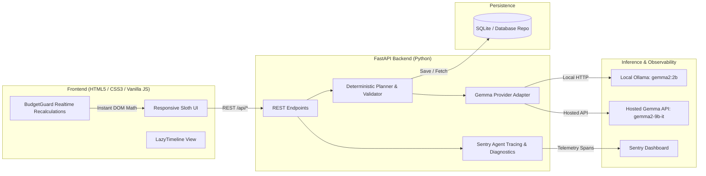

# EventPilot AI — Plan Less, Celebrate More 🦥

> **Hacktoberfest Prize-Focused Implementation**  
> Target Categories:
> 1. **Best Use of Render**
> 2. **Best Use of Gemma**
> 3. **Best Use of Sentry Agent Tracing**

[](https://opensource.org/licenses/MIT)
[](https://fastapi.tiangolo.com)
[](https://ai.google.dev/gemma)
[](https://render.com)
[](https://sentry.io)
[](https://pytest.org)

**EventPilot AI** is an open-source, GenAI-powered web application built for the Hacktoberfest theme: *“Channel Your Inner Sloth — build something that does the work so you don't have to.”* Enter your event details once, and EventPilot AI generates an editable, budget-aware plan with itemized allocations, automated preparation milestones, actionable vendor interview questions, and shopping checklists.

**Core Tagline:** *You celebrate. EventPilot handles the planning.*

---
---

## 📸 Screenshots & Interface Previews

| Dashboard Overview | Event Creation Form |
| :---: | :---: |
| *(Screenshot Placeholder: Sloth Mascot hero, metric KPI cards, recent event list)* | *(Screenshot Placeholder: Multi-field form with budget, venue, food, and culture settings)* |

| BudgetGuard & Allocations | LazyTimeline & Checklists |
| :---: | :---: |
| *(Screenshot Placeholder: Real-time budget progress bar, over-budget warnings, itemized costs)* | *(Screenshot Placeholder: Phase-grouped preparation milestones with overdue badges)* |

| Sentry Agent Tracing | Vendor Quote Tracker |
| :---: | :---: |
| *(Screenshot Placeholder: Sentry performance waterfall showing event_plan.* spans)* | *(Screenshot Placeholder: AI estimated cost vs. user-entered vendor quotes)* |

---

## 🏗 Architecture Diagram



---

## 🛠 Prerequisites

- **OS:** Windows 10/11, macOS, or Linux.
- **Python:** 3.10 to 3.14.
- **Memory:** 8 GB RAM (runs on CPU inference without dedicated GPU).
- **Ollama (Optional for local AI):** [Download Ollama](https://ollama.com/download).

---

## 🚀 Quickstart Guide (Windows PowerShell)

### 1. Clone Repository & Install Dependencies
```powershell
git clone https://github.com/your-username/eventpilot-ai.git
cd eventpilot-ai
python -m pip install -r requirements.txt
```

### 2. Configure Environment
Copy `.env.example` to `.env`:
```powershell
Copy-Item .env.example .env
```
Default local settings:
```ini
AI_PROVIDER=ollama
GEMMA_MODEL=gemma2:2b
INFERENCE_BASE_URL=http://localhost:11434
SENTRY_DSN=""
SENTRY_ENVIRONMENT=development
PORT=8000
HOST=0.0.0.0
```

### 3. Local Gemma Setup with Ollama
Pull the lightweight Gemma 2B model:
```powershell
ollama pull gemma2:2b
```
*(If on constrained hardware, `gemma:2b` or `gemma3:1b` can also be configured).*

### 4. Run the Application
```powershell
python -m uvicorn backend.main:app --port 8000 --host 0.0.0.0 --reload
```
Open in your browser:
```
http://localhost:8000
```
Interactive Swagger API docs: `http://localhost:8000/docs`

---
## 🧪 Automated Testing

EventPilot AI includes 10 automated unit and integration tests:

```powershell
python -m pytest tests -v
```

**Test Coverage:**
- Health & environment reporting (`test_health_endpoint`)
- Gemma connection status query (`test_model_status_endpoint`)
- Diagnostic telemetry buffer verification (`test_diagnostics_endpoint`)
- Demo mode generation & span recording (`test_generate_event_demo_mode_records_span`)
- Input validation & bad payload rejection (`test_generate_validation_failure`)
- SQLite repository full lifecycle CRUD (`test_save_and_retrieve_event_lifecycle`)
- Deterministic budget math & rounding balance (`test_deterministic_budget_calculation`)
- Real-time over-budget threshold detection (`test_over_budget_detection_and_recalculation`)
- Task deadline offsets and overdue calculations (`test_date_math_and_overdue_tasks`)
- Fallback schema validation (`test_demo_plan_generation`)

---

## 🔌 API Reference

| Method | Endpoint | Description |
| :--- | :--- | :--- |
| `GET` | `/api/health` | Health check and telemetry status for Render monitoring. |
| `GET` | `/api/model/status` | Real-time connectivity status of configured Gemma model. |
| `GET` | `/api/diagnostics` | In-memory telemetry summary (latency, success rates). |
| `POST` | `/api/events/generate` | Generates a validated event plan via Gemma or demo mode. |
| `POST` | `/api/events` | Saves an event plan to SQLite. |
| `GET` | `/api/events` | Retrieves all saved event summaries. |
| `GET` | `/api/events/{event_id}` | Retrieves full event plan by ID. |
| `PUT` | `/api/events/{event_id}` | Updates existing event tasks, quotes, or allocations. |
| `DELETE`| `/api/events/{event_id}` | Deletes an event from the database. |

---

## ⚠️ Limitations & Hardware Notes

- **Local 8 GB RAM Considerations:** Running local models on CPU takes 20–45s per generation depending on background workloads. A **"Force Instant Demo Mode"** toggle is provided for instant UI verification without waiting on inference.
- **Estimated Pricing Disclaimer:** AI-generated costs are initial planning estimates. Users enter real quotes directly into the quote comparison table.

---

## 🤝 Contributing & License

Contributions are welcome! Please open an issue or pull request.
Licensed under the [MIT License](LICENSE).
