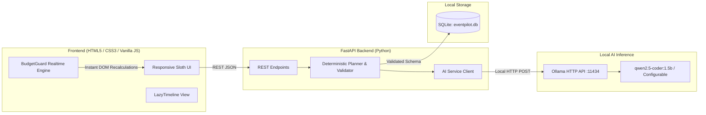

# EventPilot AI — Plan Less, Celebrate More 🦥

> **Hacktoberfest Challenge Theme:**  
> *“Channel Your Inner Sloth — build something that does the work so you don't have to.”*

[](https://opensource.org/licenses/MIT)
[](https://fastapi.tiangolo.com)
[](https://ollama.com)
[](https://pytest.org)

**EventPilot AI** is an open-source, GenAI-powered event planning companion for birthdays, weddings, college fests, community gatherings, and milestone celebrations. Enter your event details once, and EventPilot AI generates an editable, budget-aware plan with itemized allocations, automated preparation milestones, actionable vendor interview questions, and shopping checklists.

---

## 🦥 Core Philosophy & Highlights

- **Channel Your Inner Sloth:** Tedious event math, timeline calculations, and vendor checklists are handled for you in seconds.
- **Genuine Open-Weight AI Inference:** Integrates with local open-weight LLMs via [Ollama](https://ollama.com) (`qwen2.5-coder:1.5b` candidate, fully configurable) with zero cloud fees and zero telemetry.
- **Deterministic BudgetGuard:** Never trusts an LLM with arithmetic. JavaScript and Python calculate every single currency allocation, remaining balance, and over-budget threshold deterministically.
- **LazyTimeline:** Computes realistic deadlines relative to your event date, automatically flags overdue preparations, and updates milestones if dates shift.
- **Vendor Quote Tracker:** Compares AI-generated cost estimates against real user-entered vendor quotes.
- **Local Persistence & Export:** Built-in SQLite database stores your plans locally. Export anytime to clean JSON or print-ready PDF summaries.
- **Lightweight & Hardware-Friendly:** Designed specifically to run on 8 GB RAM systems with integrated CPU graphics without melting your system.

---

## 📸 Screenshots & Interface Previews

| Dashboard Overview | Event Generation Flow |
| :---: | :---: |
| *(Screenshot Placeholder: Dashboard with Sloth Mascot, stats KPI cards, and recent events)* | *(Screenshot Placeholder: Friendly multi-field event creation form)* |

| BudgetGuard & Calculations | LazyTimeline & Checklists |
| :---: | :---: |
| *(Screenshot Placeholder: Real-time progress bar, itemized costs, over-budget warnings)* | *(Screenshot Placeholder: Preparation milestones, phases, overdue task alerts)* |

---

## 🏗 Architecture Overview



---

## 🛠 Prerequisites

- **Operating System:** Windows 10/11 (or macOS / Linux).
- **Python:** Python 3.10 to 3.14.
- **Ollama:** Installed and running locally ([Download Ollama](https://ollama.com/download)).
- **RAM:** Minimum 8 GB RAM (runs on CPU inference without dedicated GPU).

---

## 🚀 Quickstart Guide (Windows PowerShell)

### 1. Clone the Repository
```powershell
git clone https://github.com/your-username/eventpilot-ai.git
cd eventpilot-ai
```

### 2. Set Up Python Environment & Dependencies
```powershell
python -m pip install -r requirements.txt
```

### 3. Install & Start Ollama
1. Download Ollama for Windows from [ollama.com/download/windows](https://ollama.com/download/windows).
2. Open PowerShell and pull the candidate lightweight model:
```powershell
ollama pull qwen2.5-coder:1.5b
```
3. Verify Ollama is running:
```powershell
ollama list
```

### 4. Configure Environment (Optional)
A `.env.example` file is provided. Copy it to `.env` if you wish to customize ports or models:
```powershell
Copy-Item .env.example .env
```
Default configuration:
```ini
OLLAMA_BASE_URL=http://localhost:11434
OLLAMA_MODEL=qwen2.5-coder:1.5b
OLLAMA_TIMEOUT_SECONDS=45
DATABASE_PATH=eventpilot.db
PORT=8000
HOST=127.0.0.1
```

### 5. Start the Application
Run the FastAPI backend (serves both API and frontend UI):
```powershell
python -m uvicorn backend.main:app --port 8000 --host 127.0.0.1 --reload
```

### 6. Open in Browser
Open your web browser and navigate to:
```
http://127.0.0.1:8000
```
- Interactive API documentation is available at: `http://127.0.0.1:8000/docs`

---

## 🤖 How the Open-Weight AI Model Is Used

1. **Structured JSON Prompting:** When you submit event parameters (type, guests, budget, venue, cultural preferences), EventPilot AI constructs a strict JSON-spec prompt.
2. **Local Inference:** The backend sends the prompt to `http://localhost:11434/api/generate` with `"format": "json"`.
3. **Deterministic Separation of Concerns:**
   - **AI generates:** Creative themes, activity schedules, suggested vendor scopes, questions to ask vendors, and shopping lists.
   - **Backend computes:** Proportional budget allocations, currency roundings, deadline calculations, and overdue flags.
4. **Graceful Fallback:** If Ollama is temporarily stopped, or on low-end hardware where pure CPU generation times out, EventPilot AI seamlessly activates a deterministic rule-based generator clearly labeled in the UI so planning is never interrupted.

### Changing the AI Model
To use another open-weight model (e.g., `llama3.2:1b`, `mistral`, or `phi3:mini`), pull it with Ollama and update your `.env`:
```powershell
ollama pull llama3.2:1b
```
Set in `.env`:
```ini
OLLAMA_MODEL=llama3.2:1b
```
Restart the server, and the UI status badge will immediately reflect the new model.

---

## 🧪 Automated Testing

EventPilot AI includes a comprehensive test suite covering API contracts, deterministic budget math, overdue milestone dates, and SQLite persistence.

Run the test suite with PowerShell:
```powershell
python -m pytest tests -v
```

Expected result:
```
tests/test_api.py::test_health_endpoint PASSED
tests/test_api.py::test_model_status_endpoint PASSED
tests/test_api.py::test_generate_event_demo_mode PASSED
tests/test_api.py::test_save_and_retrieve_event PASSED
tests/test_planner.py::test_fallback_plan_generation PASSED
tests/test_planner.py::test_deterministic_budget_calculation PASSED
tests/test_planner.py::test_over_budget_detection_and_recalculation PASSED
tests/test_planner.py::test_date_math_and_overdue_tasks PASSED
======================== 8 passed in 0.88s ========================
```

---

## 🔌 API Reference

| Method | Endpoint | Description |
| :--- | :--- | :--- |
| `GET` | `/api/health` | Backend health check and application version. |
| `GET` | `/api/model/status` | Real-time check of Ollama connection and model readiness. |
| `POST` | `/api/events/generate` | Generates a validated event plan via Ollama or demo fallback. |
| `POST` | `/api/events` | Saves an event plan to SQLite. |
| `GET` | `/api/events` | Retrieves all saved events with completion summaries. |
| `GET` | `/api/events/{event_id}` | Retrieves full event plan by ID. |
| `PUT` | `/api/events/{event_id}` | Updates existing event tasks, quotes, or budget allocations. |
| `DELETE`| `/api/events/{event_id}` | Deletes an event from the database. |

---

## ⚠️ Limitations & Hardware Notes

- **CPU Inference Speed on 8 GB RAM:** Pure CPU inference on Windows without AVX2 or dedicated GPU can be slow on large token contexts. The backend uses a configurable 45-second timeout and lightweight prompts. If Ollama takes longer on your CPU, you can increase `OLLAMA_TIMEOUT_SECONDS` in `.env` or toggle the **"Instant Demo Mode"** checkbox in the form.
- **Mock / Estimated Pricing:** All prices provided by AI are estimates. EventPilot AI never invents verified vendors or live market availability; vendor names and quotes must be entered directly by the user.
- **Local Deployment:** When deploying to hosts like Render or Railway, configure an external Ollama endpoint or use the deterministic planner, as cloud free tiers typically do not provide local Ollama instances.

---

## 🤝 Contributing

Contributions are warmly welcomed for Hacktoberfest and beyond!
1. Fork the Project.
2. Create your Feature Branch (`git checkout -b feature/SlothSuperpower`).
3. Commit your Changes (`git commit -m 'Add sloth-themed event templates'`).
4. Push to the Branch (`git push origin feature/SlothSuperpower`).
5. Open a Pull Request.

---

## 📄 License

This project is licensed under the MIT License — see the [LICENSE](LICENSE) file for details.
