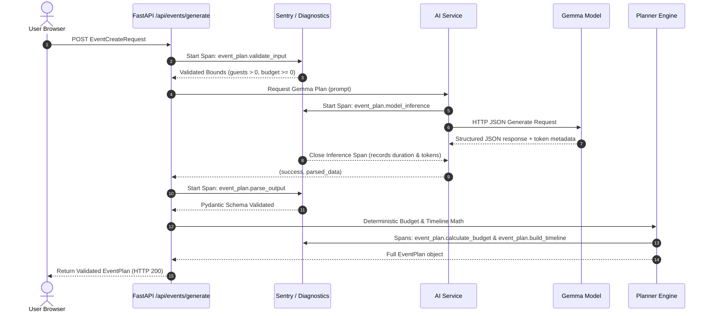
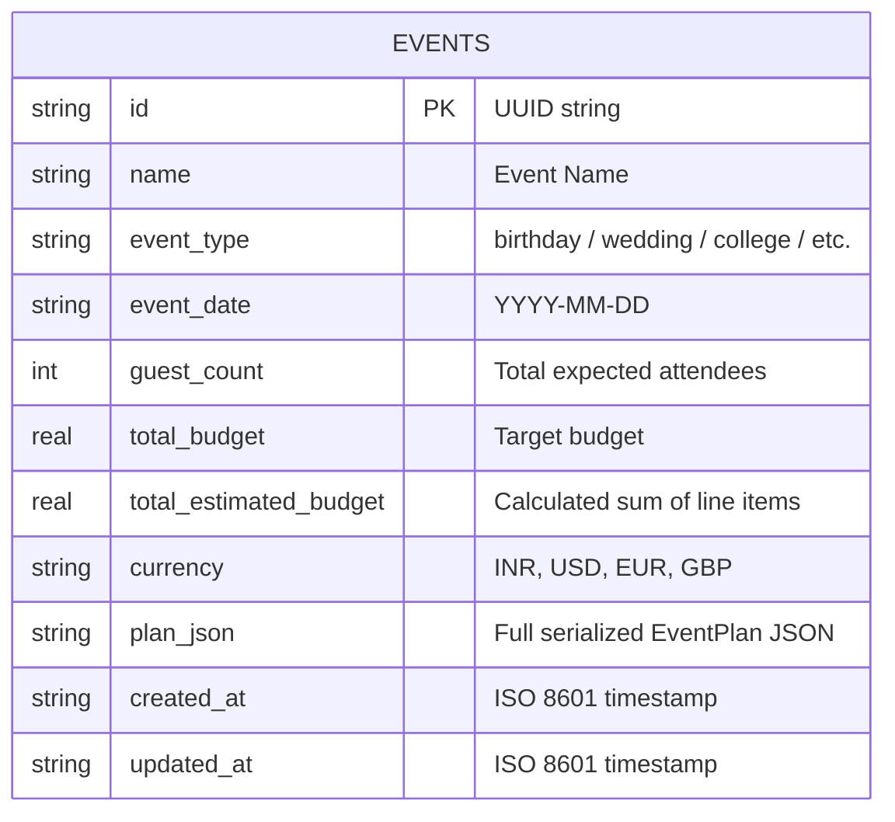

# EventPilot AI — Architecture & Data Flow

This document details the actual system architecture, component boundaries, and data flows implemented in EventPilot AI.

---

## 1. System Architecture

```mermaid
graph TD
    Client["Browser (Vanilla HTML5 / CSS3 / ES6)"]
    FastAPI["FastAPI Web Service (backend/main.py)"]
    Obs["Sentry Tracing & Diagnostics (backend/observability.py)"]
    Planner["Deterministic Planner (backend/planner.py)"]
    AIService["AI Inference Adapter (backend/ai_service.py)"]
    DB[(SQLite: eventpilot.db)]
    
    subgraph External Inference
        OllamaLocal["Local Ollama (:11434)<br/>gemma2:2b / qwen2.5-coder:1.5b"]
        HostedGemma["Hosted Gemma API<br/>Groq / Together / OpenRouter (gemma2-9b-it)"]
    end

    Client -->|REST JSON / HTTP| FastAPI
    FastAPI --> Obs
    FastAPI --> Planner
    Planner --> AIService
    AIService -.->|HTTP POST| OllamaLocal
    AIService -.->|HTTPS POST (OpenAI format)| HostedGemma
    Planner -->|SQL Parameterized| DB
    DB -->|Read / Write| FastAPI
    FastAPI -->|JSON Response| Client
```

---

## 2. AI Planning Pipeline & Sentry Tracing Spans



---

## 3. SQLite Database Schema


